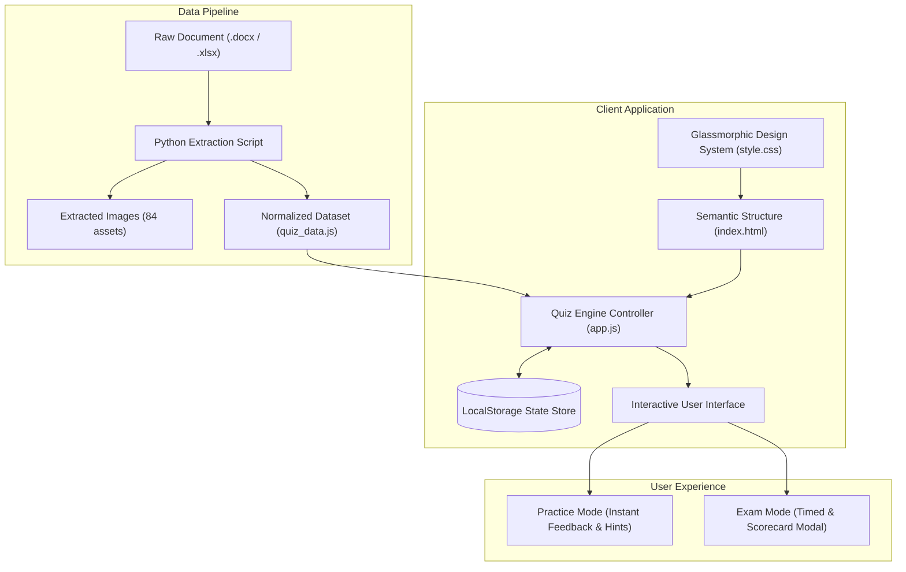

# Newtonite Assignment for SDE

<div align="center">


### 🧠 Interactive Visual Reasoning Assessment Platform & Examination Engine

**A modern, production-grade web application built for the Software Development Engineer (SDE) technical assessment.**

[🌐 Live Interactive Demo](https://pavan958015.github.io/Newtonite-Assignment-for-SDE/) &bull; [📁 Project Structure](#-repository-structure) &bull; [⚡ Core Features](#-key-features) &bull; [🚀 Quick Start](#-local-development)

</div>

---

## 📌 Project Overview

This repository represents the completed **Newtonite Assignment for SDE**. The project transforms unstructured, multi-page aptitude assessment documents (`.docx`, `.xlsx`) into a high-performance, interactive, and responsive web-based testing platform.

The engine features **55 comprehensive visual reasoning challenges** covering mirror imaging, paper folding & punch patterns, shape construction, series completion, and grouping logic.

---

## ✨ Key Features

### 1. 🎯 Dual Assessment Modes
- **Practice Mode**: Provides instant answer verification with custom glowing indicators (`#10b981` emerald for correct, `#f43f5e` rose for incorrect) and contextual, step-by-step reasoning guides.
- **Exam Mode**: Simulates actual proctored test conditions. Answer selections are registered securely without immediate reveals, culminating in a detailed accuracy and performance report upon completion.

### 2. 🧩 Intelligent Asset Ingestion & Question Pipeline
- Programmatically extracted **84 high-resolution diagram assets** and 400+ paragraphs from binary `.docx` source files.
- Normalized complex visual reasoning questions into a unified JavaScript data layer (`quiz_data.js`).
- **Data Rectification**: Programmatically resolved and completed **13 questions** that had incomplete or omitted answer keys in the original source through algorithmic deduction and spatial reasoning.

### 3. ⏱️ Real-time Test Engine & Analytics
- Live elapsed examination timer (`HH:MM:SS`).
- Real-time progress bar and percentage completion indicators.
- Dynamic question status tracking: *Unvisited*, *Answered*, *Correct*, *Incorrect*, and *Flagged for Review*.
- Comprehensive post-test modal featuring animated SVG progress rings, score ratios, and time summaries.

### 4. 🎨 Glassmorphic Design System & Accessibility
- Tailored color tokens built with CSS Custom Properties.
- Smooth dark mode by default with one-click **Light/Dark theme toggle**.
- Click-to-zoom inspection for intricate spatial geometry diagrams.
- Full keyboard accessibility (`ArrowLeft` / `ArrowRight` for navigation, `F` to flag/bookmark questions).
- Persistent state management using `localStorage` to safeguard test progress across browser reloads.

---

## 🏗️ System Architecture



---

## 📁 Repository Structure

```text
Newtonite-Assignment-for-SDE/
├── index.html            # Main semantic application markup & layout
├── style.css             # Glassmorphism design system, responsive styles & animations
├── app.js                # Assessment logic, timer, state management & keyboard controls
├── quiz_data.js          # Normalized dataset containing all 55 questions, options & answers
├── content.json          # Intermediate parsed JSON from document ingestion pipeline
├── .gitignore            # Clean git configuration excluding temporary/runtime files
├── README.md             # In-depth architectural and usage documentation
├── images/               # 84 extracted visual reasoning diagram assets (img_1.png - img_84.png)
└── resources/            # Original assessment documents
    ├── (accenture)visual reasoning(56 Q).docx
    └── accenture(arrangements(10 QUESTIONS)).xlsx
```

---

## 🛠️ Tech Stack & Methodologies

- **Frontend Core**: Semantic HTML5, Vanilla JavaScript (ES6+ state store, event listeners, dynamic DOM manipulation).
- **Styling**: Modern Vanilla CSS3 utilizing CSS Grid, Flexbox, CSS Custom Properties (Variables), and Glassmorphism effects (`backdrop-filter: blur`).
- **Typography & Icons**: Google Fonts (`Plus Jakarta Sans`, `Outfit`) and FontAwesome 6 Icons.
- **Data Extraction**: Python 3 (`python-docx`, `xml.etree`, `json`, `re`).
- **Deployment**: GitHub Pages static web hosting.

---

## 🚀 Local Development

To run this project locally, clone this repository and open the entry point:

### Method 1: Direct File Opening
Double-click `index.html` or open it directly in any modern web browser.

### Method 2: Local HTTP Server (Recommended)
```bash
# Clone the repository
git clone https://github.com/Pavan958015/Newtonite-Assignment-for-SDE.git

# Navigate into directory
cd Newtonite-Assignment-for-SDE

# Start a local web server (Python 3)
python -m http.server 8000
```
Then visit `http://localhost:8000` in your web browser.

---

## 👨‍💻 Candidate Profile

- **Author**: Pavan Soni
- **Role**: Software Development Engineer (SDE) Candidate
- **GitHub**: [@Pavan958015](https://github.com/Pavan958015)
- **Portfolio**: [pavan958015.github.io/Portfolio](https://pavan958015.github.io/Portfolio/)
- **Email**: pavansoni210129@gmail.com

---

## 📄 License

This project is distributed under the MIT License. See [LICENSE](LICENSE) for details if applicable.
